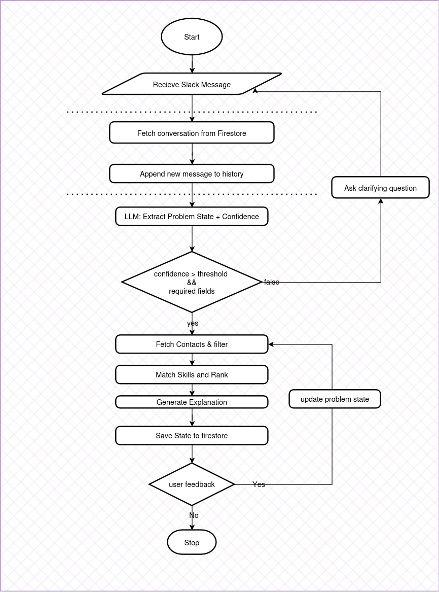
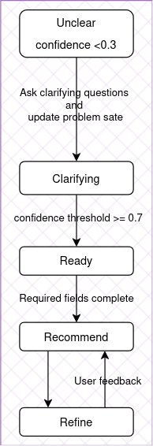

#  Slack Butterfly

[](https://nextjs.org)
[](https://www.typescriptlang.org)
[](https://vercel.com)
[](https://slack.com)
[](https://firebase.google.com)
[](https://groq.com)
[](https://openai.com)
[](https://tavily.com)


<!-- state diagram: public/sb_statemachine.drawio.png -->
<!-- flow diagram: public/sb_flowchart.drawio.png -->

Slack Butterfly is a Slack bot that helps you find the right people in your workspace to solve a problem.

It does this by:

- asking a few targeted questions
- maintaining a structured problem state
- matching that state against available contacts
- returning a short, ranked list with reasoning

The system is stateful — each message updates its understanding instead of starting from scratch.


## Architecture

<!-- architecture diagram: public/SlackButterflyArchitecture.png -->


The system is split into four layers:

- **Interface** — Slack (DM-based interaction)
- **Orchestration** — Next.js API route handling events
- **Agent Logic**
  - Conversation manager (history + state)
  - LLM analyzer (structured extraction)
  - Policy engine (clarify vs recommend)
  - Recommendation engine (ranking + explanation)
- **Data** — Firestore (conversation state, cached profiles)

External services:

- Slack API (events + user data)
- LLM providers (Groq / OpenAI)
- Tavily (contacts enrichment)

## Conversation Flow



1. Message received from Slack  
2. Conversation state loaded from Firestore  
3. LLM extracts structured fields + confidence  
4. Policy decides:
   - ask a follow-up question  
   - or generate recommendations  
5. Response is sent and state is updated  


## Agent Design



The system operates in two modes:

**Clarifying**

- Triggered when required fields are missing or confidence is low
- Asks specific follow-up questions

**Recommending**

- Triggered when the problem is sufficiently defined
- Retrieves contacts, ranks them, and explains matches


## Data Model


- Every user message refines the problem statement and updates the conversation state until it's ready for recommendations.

```
problemState: {
  rawConversation: Message[],

  structured: {
    problemType: "technical" | "organizational" | "research" | "career" | ...,

    summary: string,

    keyNeeds: string[],        // e.g. ["nlp", "deployment", "scalability"]
    constraints: string[],     // e.g. ["fast turnaround", "production system"]
    urgency: "low" | "medium" | "high",

    entities: {
      tools?: string[],
      domains?: string[],
      systems?: string[]
    }
  },

  confidence: number,

  lastUpdated: timestamp,

  version: number
}
```

Conversations are scoped per workspace and user:

```

conversations: {
  "slackUserId": {
    messages: [
      {
        role: "user",
        content: "I need help with NLP project",
        timestamp: "..."
      },
      {
        role: "bot",
        content: "Can you clarify…",
        timestamp: "..."
      }
    ],

    state: "clarifying" 
    // or: "ready_to_recommend"
  }
}
```

Contacts are stored (or derived) separately:

```
contacts: {
  "U123": {
    name: "Ali Khan",
    title: "ML Engineer",
    organization: "Acme Inc",

    slackData: {
      email: "...",
      avatar: "...",
    },

    enrichedData: {
      skills: ["python", "nlp", "ml"],
      experience: "Worked on recommendation systems",
      sources: ["linkedin", "github"]
    },

    keywords: ["ml", "ai", "data"],

    "summary": "Worked on transformer-based NLP systems", 


    lastUpdated: "timestamp"
  }
}
```


## Setup

1. Clone the repo and install dependencies:

```bash
cd slack-butterfly
npm install
npm run build
npm run start
```

2. Use ngrok or similar to expose your local server for Slack events:

```bash
ngrok http 3000
```

3. Create a Slack app with permissions for reading messages and user profiles. Set the event subscription URL to your ngrok URL + `/api/slack/events`.

4. Set environment variables for Slack tokens, LLM API keys, and Firestore credentials.

5. Start chatting with the bot in Slack and watch the conversation state evolve in Firestore!

## Future Improvements

- Add a feedback loop to learn from user interactions and improve recommendations over time.

- Integrate with more data sources for richer contact profiles (e.g. GitHub, LinkedIn).

- Implementing a more sophisticated ranking algorithm that takes into account not just relevance but also factors like the contact's availability, past interactions with the user, and mutual connections.

- Organizations may be able to provide access to data such as the resumes of their employees, which would allow for much richer profiles and more accurate recommendations. If such data were available, the agent could be designed to leverage it effectively while ensuring privacy and security considerations are met.

