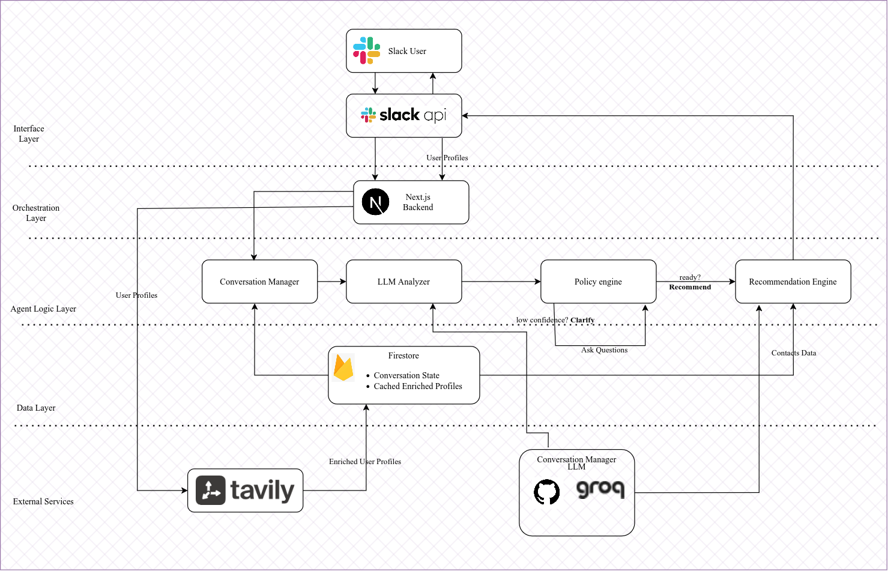

#  Slack Butterfly

[](https://nextjs.org)
[](https://www.typescriptlang.org)
[](https://vercel.com)
[](https://slack.com)
[](https://firebase.google.com)
[](https://groq.com)
[](https://openai.com)
[](https://tavily.com)


<!-- state diagram: public/sb_statemachine.drawio.png -->
<!-- flow diagram: public/sb_flowchart.drawio.png -->

Slack Butterfly is a Slack bot that helps you find the right people in your workspace to solve a problem.

It does this by:

- asking a few targeted questions
- maintaining a structured problem state
- matching that state against available contacts
- returning a short, ranked list with reasoning

The system is stateful — each message updates its understanding instead of starting from scratch.


## Architecture

<!-- architecture diagram: public/SlackButterflyArchitecture.png -->


The system is split into four layers:

- **Interface** — Slack (DM-based interaction)
- **Orchestration** — Next.js API route handling events
- **Agent Logic**
  - Conversation manager (history + state)
  - LLM analyzer (structured extraction)
  - Policy engine (clarify vs recommend)
  - Recommendation engine (ranking + explanation)
- **Data** — Firestore (conversation state, cached profiles)

External services:

- Slack API (events + user data)
- LLM providers (Groq / OpenAI)
- Tavily (optional enrichment)

## Conversation Flow

1. Message received from Slack  
2. Conversation state loaded from Firestore  
3. LLM extracts structured fields + confidence  
4. Policy decides:
   - ask a follow-up question  
   - or generate recommendations  
5. Response is sent and state is updated  


## Agent Design

The system operates in two modes:

**Clarifying**

- Triggered when required fields are missing or confidence is low
- Asks specific follow-up questions

**Recommending**

- Triggered when the problem is sufficiently defined
- Retrieves contacts, ranks them, and explains matches


## Data Model

Conversations are scoped per workspace and user:

```
```
Contacts are stored (or derived) separately:

```
```


## Setup

For usage (Slack workspace)

- Create a Slack app at <https://api.slack.com/apps>
- Go to App Manifest and paste the contents of `slack-butterfly-manifest.json` (file can be found in root directory)


